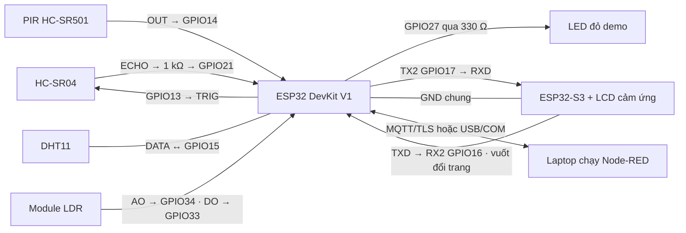

# SmartMirror — ESP32 + Node-RED

Bản này gồm firmware ESP32, mô phỏng Wokwi, ứng dụng Android viết bằng Flutter và backend Node-RED. Khi triển khai theo USB, điện thoại chạy app, laptop nhận lịch và chuyển dữ liệu tới ESP32 qua cổng COM. Wokwi dùng MQTT qua TLS để mô phỏng.

Nếu mặt sau màn ghi **ESP32-S3 320×480 Capacitive Touch**, xem [sơ đồ hai bo, bảng chân và cách nạp](#mạch-thật-dùng-hai-bo-và-màn-cảm-ứng-điện-dung-35-inch).

## Chạy ngay trên Windows

Cần Node.js, Node-RED, Flutter SDK, Android SDK và PlatformIO. Nếu chưa có Node-RED:

```powershell
npm.cmd install -g node-red
```

Tại thư mục dự án:

```powershell
Set-Location D:\IOT\SmartMirror
powershell -NoProfile -ExecutionPolicy Bypass -File scripts/start-dashboard.ps1 -ReloadFlow
```

Script dùng Node-RED ở `127.0.0.1:1881`, HTTPS, mã kết nối và thư mục lưu riêng `.runtime/`.
Không bật truy cập LAN. `-ReloadFlow` nạp cấu hình từ project vào runtime.
Lần chạy đầu tự tạo khóa HTTPS riêng trong `.runtime/` và cập nhật chứng chỉ công khai vào app; sau đó `flutter run` sẽ build app với chứng chỉ đúng cho máy đó. Khóa riêng và mã ghép nối không được đẩy lên Git.

### App Android qua cáp USB

1. Bật Tùy chọn nhà phát triển và Gỡ lỗi USB trên điện thoại; cắm điện thoại vào laptop và chấp nhận hộp thoại tin cậy.
2. Chạy script trên. Script tự cấu hình ADB reverse cho emulator/điện thoại đang được ADB cấp quyền.
3. Mở app, vào Cài đặt kết nối, nhập mã kết nối đang hiện trong cửa sổ PowerShell.
4. Lịch đi qua HTTPS cục bộ tới laptop. Không cần Wi-Fi chung hay Internet cho luồng điều khiển.

### ESP32 qua USB/COM

Kết nối ESP32 với laptop bằng cáp USB dữ liệu, xem tên cổng trong Device Manager rồi chạy ví dụ:

```powershell
powershell -NoProfile -ExecutionPolicy Bypass -File scripts/start-dashboard.ps1 -SerialPort COM5 -ReloadFlow
```

Thay `COM5` bằng cổng thật. Cùng một cổng COM chỉ được một chương trình mở; dừng Node-RED trước khi upload firmware.
Giao thức nối COM dùng 115200 baud, 8-N-1, dữ liệu UTF-8 kết thúc bằng newline.
App → HTTPS/USB reverse → laptop → serial COM → ESP32. Trạng thái ESP32 chạy ngược về laptop và app.

### Emulator và APK

Giữ Node-RED chạy, mở terminal khác:

```powershell
Set-Location D:\IOT\SmartMirror\mobile_app
flutter devices
flutter run -d emulator-5554
```

APK debug: `mobile_app\build\app\outputs\flutter-apk\app-debug.apk` (tạo bằng `flutter build apk --debug`).
Không thể xác nhận kết nối phần cứng thật cho tới khi có điện thoại và ESP32 thật để thử.

Tiếp tục chạy firmware trong Wokwi. Đặt HC-SR04 ở **70 cm**, sau đó chọn **Simulate Motion** trên PIR để đánh thức gương. Vuốt ngang trực tiếp trên TFT để đổi trang. Bấm LDR để thay đổi độ rọi; LED xanh mô phỏng đèn gương chỉ sáng khi gương hoạt động và môi trường tối, LED trắng mô phỏng PWM đèn nền TFT. Các nút tháng và lịch hẹn nằm trong ứng dụng lịch.
Khi người rời khỏi vùng 1 m, gương ngủ sau 30 giây; khi mất số đo khoảng cách, gương tắt sau 10 giây. Đặt HC-SR04 ở **150 cm** rồi thử chuyển động để kiểm tra gương không bật ngoài vùng.
Ctrl+C tại Terminal để dừng Node-RED.

## Lấy vị trí thật và thời tiết — không cần API key

Có hai API thật: Open-Meteo Geocoding để tìm địa điểm và Forecast để lấy thời tiết.
Gói API công cộng này phù hợp dự án cá nhân, phi thương mại theo điều kiện của nhà cung cấp.

### Cách 1: Tìm địa điểm

1. Mở giao diện web Node-RED ở máy tính, kéo xuống **Vị trí thời tiết**.
2. Nhập `Đà Nẵng`, `Hà Nội`, hoặc tên nơi bạn cần; nhấn **Tìm địa điểm**.
3. API trả danh sách kết quả thật; chọn đúng thành phố/tỉnh/quốc gia.
4. Node-RED lưu tọa độ và tự lấy thời tiết hiện tại cùng dự báo 3 ngày.
5. Tự cập nhật mỗi 15 phút; nút Cập nhật cho phép gọi sớm hơn (giới hạn tối thiểu 10 giây).

### Cách 2: Định vị thiết bị

1. Mở Dashboard bằng `https://localhost:1881` trên máy tính chạy Node-RED.
2. Nhấn **Dùng vị trí của tôi**.
3. Khi trình duyệt hỏi, chọn **Cho phép / Allow**. Có thể phải bật Location của Windows.
4. Trình duyệt trả tọa độ (không nhất thiết từ GPS); độ chính xác phụ thuộc thiết bị.
5. Tọa độ được làm tròn, lưu tại máy Node-RED và gửi tới Open-Meteo khi lấy thời tiết.

Không tự định vị khi mở trang; chỉ thực hiện sau khi bạn nhấn nút.
Vị trí là cấu hình chung của gương, không phải vị trí độc lập của từng điện thoại.
Nút **Xóa vị trí đã lưu** xóa cấu hình vị trí và dữ liệu thời tiết tại Node-RED.

Trình duyệt chỉ cho định vị ở HTTPS hoặc localhost. Nếu truy cập bằng IP LAN qua HTTP,
hãy dùng tìm tên địa điểm. Không cần đăng ký tài khoản hoặc gửi API key cho người khác.

Tài liệu: [Geocoding API](https://open-meteo.com/en/docs/geocoding-api),
[Forecast API](https://open-meteo.com/en/docs),
[quyền định vị trình duyệt](https://developer.mozilla.org/en-US/docs/Web/API/Geolocation/getCurrentPosition).

## Giao diện và logic

- **Tổng quan:** giờ/ngày Việt Nam, nhiệt độ/độ ẩm trong phòng, trạng thái đèn gương và độ sáng tự động.
- **Thời tiết:** số liệu ngoài trời theo vị trí chọn, dự báo 3 ngày và thời điểm cập nhật.
- **Lịch hoạt động:** xem lịch tháng, chọn ngày, thêm/sửa/xóa hoạt động và đánh dấu hoàn thành.
- Vuốt ngang trái/phải trên TFT để chuyển Tổng quan → Thời tiết → Lịch hôm nay. Mỗi lần vuốt chỉ đổi một trang.
- Khi SLEEP, gương nền đen. Khi ACTIVE trở lại, quay về Tổng quan.
- Các trình duyệt cùng xem trạng thái và trang gương do Node-RED quản lý chung.
- Lịch nhập theo giờ Việt Nam UTC+7, kể cả khi múi giờ điện thoại khác.
- Khi cảm biến đánh thức gương, lịch của ngày hiện tại được gửi lên TFT và hiển thị trên trang gương.
- Nhiệt độ/độ ẩm không có mẫu mới 15 giây sẽ hiện `--`; các lệnh bị khóa khi thiết bị chưa có dữ liệu mới.
- Thời tiết cũ quá 30 phút được gắn nhãn; lỗi API giữ bản cũ kèm thông báo.
- Đèn gương chỉ sáng khi gương ACTIVE và phòng tối; đèn gương riêng và đèn nền TFT tự chỉnh bằng cùng cảm biến LDR. Màn hình sáng hơn khi phòng sáng và giảm sáng trong phòng tối.
- HC-SR04 cần ba mẫu liên tiếp trong vùng **2 cm đến 1 m**, ghép với cạnh lên PIR trong cửa sổ 3 giây. Mỗi cạnh PIR chỉ dùng một lần.
- Đặt hai mắt siêu âm lộ ra phía trước và hướng về vùng đứng soi. Đồ vật gần có thể thỏa khoảng cách nhưng không tự đánh thức gương nếu PIR không phát hiện chuyển động.
- MQTT dùng TLS cổng 8883 và xác minh CA/chứng chỉ máy chủ ở Node-RED lẫn ESP32. Luồng app điện thoại qua HTTPS/USB và luồng ESP32 qua USB/COM không phụ thuộc MQTT.
- Wokwi đang dùng broker EMQX công cộng: TLS mã hóa đường truyền và xác minh đúng máy chủ, nhưng broker công cộng là môi trường chia sẻ; không gửi dữ liệu riêng tư lên đó. Bản thật nên dùng broker riêng có TLS, tài khoản và ACL. Không bỏ xác minh chứng chỉ.
- Lịch sử: một mẫu hợp lệ/phút, tối đa 24 giờ trong phiên chạy; xuất CSV có nhiệt độ và độ ẩm.
- Lưu lịch/vị trí qua khởi động lại; lịch sử và trạng thái online không được khôi phục như dữ liệu mới.
  File context có thể cần tới 30 giây để flush; dừng bằng Ctrl+C để đóng sạch.

## Kết nối trực tiếp giữa app và gương

App không nói chuyện trực tiếp với ESP32. Điện thoại kết nối laptop bằng USB đã được ủy quyền;
ADB reverse chuyển kết nối app tới dịch vụ HTTPS chỉ lắng nghe trên localhost. Node-RED chuyển
lịch và nội dung màn hình qua USB/COM tới ESP32, rồi nhận trạng thái cảm biến và đèn ngược về app.
Mã kết nối được tạo cục bộ, app lưu mã trong Android Keystore, và chứng chỉ TLS riêng của dự án
được ghim trong app. Không mở dịch vụ ra mạng LAN/Internet. Đây là cấu hình thử nghiệm/đồ án;
USB debugging phải bật và chỉ nên ủy quyền laptop tin cậy.

## Nếu muốn import vào Node-RED cũ ở cổng 1880

1. Export bản flow hiện tại để dự phòng.
2. Cài `@flowfuse/node-red-dashboard` (Dashboard 2).
3. Thay flow SmartMirror cũ bằng `flows.json`, không để hai flow cùng subscribe/phát lệnh trùng.
4. Deploy; thay 1881 bằng 1880 trong các đường dẫn trên.
5. Để lịch/vị trí lưu qua khởi động lại, hợp nhất mục sau vào `settings.js` rồi restart:

```javascript
contextStorage: {
    default: 'memoryOnly',
    memoryOnly: { module: 'memory' },
    file: { module: 'localfilesystem' }
},
```

Script chạy riêng đã có cấu hình này sẵn. Không chạy song song hai Node-RED dùng chung `flows.json`.

## Mạch thật dùng hai bo và màn cảm ứng điện dung 3,5 inch

Cấu hình này dành cho **ESP32 DevKit V1/WROOM-32 + bo màn LCDWiki ES3C35P**. Đối chiếu mẫu màn trước khi nạp: mặt sau ghi “3.5″ LCD Display / ESP32-S3 320×480 / Capacitive Touch”, có giắc UART, I2C (IO38/39), GPIO (IO45/46), BAT và SPEAKER. Driver dùng ST77922 qua QSPI, cảm ứng I²C và đèn nền ở GPIO41. [Tài liệu phần cứng và hình đối chiếu](https://www.lcdwiki.com/res/ES3C35P/3.5inch_IPS_ESP32-S3_Specification_V1.0.pdf)



### Dây giữa hai bo

Mở [diagram.hardware.json](diagram.hardware.json) để xem dây nối và vị trí điện trở trên breadboard. Ký hiệu ESP32-S3 bên phải đại diện cho bo màn ES3C35P. Trên bo thật, ba dây đi vào giắc ghi **UART**.

Dùng giắc **UART 4 chân bước 1,25 mm** khớp ổ trên bo màn, đọc nhãn in trên PCB trước khi cắm. UART dùng mức logic 3,3 V, tốc độ 115200, 8N1. Mỗi bo nhận nguồn từ cáp USB riêng.

| ESP32 DevKit V1 | Giắc UART trên bo màn | Chức năng |
| --- | --- | --- |
| GPIO17 (TX2) | RXD (IO44) | Trạng thái thức/ngủ, mức sáng, nhiệt độ, độ ẩm, trang và nội dung lịch/thời tiết |
| GPIO16 (RX2) | TXD (IO43) | Cử chỉ vuốt để đổi trang và gia hạn thời gian dùng |
| GND | GND | Mốc điện áp chung |
| — | 5V | Để hở khi cấp nguồn riêng bằng USB |

### Dây trên DevKit và breadboard

Ngắt nguồn khi đi dây. Lấy 5 V từ chân VIN/5V của DevKit **có 5 V từ USB** để nuôi HC-SR04 và PIR. Dành một thanh nguồn riêng cho 3V3 và nối các chân GND về cùng thanh âm. Đặt hai chân LED vào hai hàng độc lập. Với ECHO, một hàng breadboard là điểm chung của GPIO21, đầu ra điện trở 1 kΩ và đầu trên điện trở 1,5 kΩ.

| Thiết bị | Dây nguồn và tín hiệu |
| --- | --- |
| HC-SR04 | VCC → 5 V, GND → GND, TRIG → GPIO13. ECHO → 1 kΩ → nút nối GPIO21, từ nút đó qua 1,5 kΩ xuống GND. |
| PIR HC-SR501 | VCC → 5 V, GND → GND, OUT → GPIO14. Chờ 60 giây sau khi cấp điện để PIR ổn định. |
| DHT11 | VCC → 3V3, OUT → GPIO15, GND → GND. Thêm 10 kΩ giữa OUT và 3V3 nếu module chưa có điện trở kéo lên. |
| Module LDR | VCC → 3V3, GND → GND, AO → GPIO34, DO → GPIO33, thêm 100 kΩ giữa GPIO34 và GND. DO lên HIGH khi tối. |
| LED đỏ demo | GPIO27 → 330 Ω → chân dài LED. Chân ngắn LED → GND. |
| Bo màn | LCD, cảm ứng và PWM đèn nền đã nối bên trong bo. DevKit gửi mức sáng qua UART. |

### Nạp và kiểm tra

Trong PlatformIO, nạp **mirror-sensors** vào DevKit và **mirror-panel-s3** vào USB-C của màn. Có thể cắm từng bo một để chọn đúng cổng. Khi dùng hai cổng cùng lúc, thay COM bên dưới bằng cổng thực tế của từng bo.

```powershell
pio run -e mirror-sensors -t upload --upload-port COM5
pio run -e mirror-panel-s3 -t upload --upload-port COM6
```

Sau khi nạp, cấp nguồn cả hai bo. Đưa vật vào 70 cm để đánh thức gương, che LDR rồi chiếu sáng lại để kiểm tra LED và đèn nền, vuốt trái/phải để đổi trang. Gỡ riêng dây DevKit TX2 → màn RXD trong lúc gương thức: màn phải ngủ sau khoảng 3 giây. Cắm lại để nhận trạng thái mới. Để thử lịch, mở backend và tạo hoạt động hôm nay trên app. Nếu dùng cầu nối USB/COM, chọn cổng **DevKit** trong script backend. Wokwi dùng cấu hình mô phỏng một bo; việc kiểm tra chân màn và cảm ứng ES3C35P thực hiện trên bo thật.

### Chế độ kiểm tra dây và cảm biến

Nạp `mirror-sensors-debug` vào DevKit và `mirror-panel-s3-debug` vào bo màn. Khi cấp nguồn, màn hiện trạng thái UART và DevKit bật LED soi ở PWM khoảng 38%. Khi nhận dữ liệu từ DevKit, màn hiện khoảng cách HC-SR04, mức HIGH/LOW của PIR, giá trị AO/DO của LDR và nhiệt độ/độ ẩm DHT. Nếu mất dữ liệu UART quá 3 giây, màn quay lại trang chờ để dễ dò dây. LED và đèn nền giữ độ sáng cố định trong chế độ này.

Sau khi kiểm tra, nạp lại `mirror-sensors` và `mirror-panel-s3` để dùng chế độ tự động theo khoảng cách và ánh sáng.

DHT11 hiện được tạm ngừng trên DevKit của mạch hai bo. Khi thay cảm biến, bỏ cờ `-DSMARTMIRROR_DHT_DISABLED` khỏi cấu hình `mirror-sensors` rồi nạp lại DevKit.

## Phương án màn rời ILI9488 – danh sách linh kiện

DHT22 đo nhiệt độ và độ ẩm để hiển thị trên TFT và điện thoại. Mạch có hai ngõ chiếu sáng độc lập, một cho đèn nền TFT và một cho dải LED soi mặt.

| SL | Thiết bị | Yêu cầu khi mua |
| ---: | --- | --- |
| 1 | ESP32 DevKit V1 dùng module ESP32-WROOM-32 | Có USB-to-UART tích hợp; đầu USB Micro-USB hoặc USB-C tùy bo. Tránh loại có PSRAM nếu vẫn dùng pin GPIO16/17 như sơ đồ. |
| 1 | TFT màu 3,5 inch ILI9488, SPI, 480×320, kèm XPT2046 | Cần đúng giao tiếp SPI và touch điện trở XPT2046; mức logic 3,3 V; có chân điều khiển đèn nền LED/BL riêng để chỉnh PWM. Hỏi người bán sơ đồ chân và VCC nhận 3,3 V hay 5 V trước khi cấp nguồn. |
| 1 | Cảm biến khoảng cách HC-SR04 | Cấp 5 V; chân ECHO phải qua mạch chia áp trước GPIO ESP32. |
| 1 | Cảm biến chuyển động PIR HC-SR501 | OUT tương thích mức logic 3,3 V, VCC 5 V. Chỉnh jumper L và TIME theo hướng dẫn lắp đặt. |
| 1 | Cảm biến nhiệt độ/độ ẩm DHT22 hoặc AM2302 | Loại module 3 chân hoặc cảm biến rời 4 chân; nếu cảm biến rời cần điện trở kéo lên DATA 10 kΩ. |
| 1 | Module quang trở LDR có ngõ AO và DO | Cấp 3,3 V để AO không vượt mức ESP32; sơ đồ còn dùng điện trở kéo xuống 100 kΩ ở GPIO34. |
| Theo kích thước gương | Dải LED soi gương | Chọn điện áp và công suất theo chiều dài; firmware chỉ phát PWM mức logic, không cấp tải LED trực tiếp từ GPIO. |
| 1 | Mạch MOSFET N-channel logic-level hoặc module MOSFET PWM | Nhận mức điều khiển 3,3 V từ ESP32 và chịu được dòng của dải LED; không dùng relay nếu muốn chỉnh sáng. |
| 1 | Nguồn riêng cho dải LED | Cùng điện áp với dải LED; chọn dòng tối thiểu theo tổng công suất, nên chừa khoảng 20–30%. GND nguồn LED nối chung với GND ESP32. |
| 1 bộ | Điện trở và dây nối | 1 kΩ + 1,5 kΩ chia áp ECHO; 10 kΩ kéo lên DHT22 rời; 100 kΩ kéo xuống GPIO34; 100–220 Ω nối cổng MOSFET và 10 kΩ kéo cổng xuống GND nếu dùng MOSFET rời. Mua bộ điện trở 1/4 W là tiện nhất. |
| 1 bộ | Dây USB dữ liệu và dây jumper | Một cáp USB dữ liệu điện thoại–laptop; một cáp USB dữ liệu ESP32–laptop, đúng đầu cắm của bo. Dây Dupont theo đầu đực/cái của module. |
| 1 | Breadboard để ráp thử | Nên dùng khi dựng và kiểm tra nguyên mẫu. Khi lắp cố định, chuyển sang PCB/perfboard hoặc đầu nối bắt vít và hộp cách điện; không để mạch treo bằng dây jumper. |
| 1 bộ nếu làm cả mặt gương | Gương bán phản xạ và khung gá | Thử độ đọc của TFT qua kính ở cả phòng sáng và tối trước khi chốt kính. Chừa cửa cho PIR, hai đầu siêu âm và cảm ứng điện trở nếu cần vuốt trực tiếp. Đặt DHT22 ở vị trí thông thoáng, LDR hướng ra phòng và tránh ánh sáng trực tiếp từ dải LED. |
| 1 nếu TFT cần | Driver đèn nền có ngõ PWM 3,3 V | Chọn theo sơ đồ và dòng LED của module TFT. Nếu module đã có ngõ DIM/EN nhận PWM 3,3 V thì dùng ngõ đó. Driver của dải LED soi mặt dùng riêng. |

**Có thể cần thêm:** bộ hạ áp ổn định 5 V xuống 3,3 V dòng phù hợp nếu module TFT yêu cầu nguồn 3,3 V riêng hoặc tổng tải vượt khả năng chân 3V3 trên DevKit. Không đoán chân VCC/LED của TFT theo tên ILI9488 vì cách làm mạch nguồn khác nhau giữa các phiên bản. Không cấp 5 V vào GPIO ESP32; không nối hai nguồn 5 V riêng vào cùng bo khi cáp USB dữ liệu còn cấp nguồn nếu chưa có cách chống cấp ngược.

Khi thử app trên điện thoại qua USB, dùng cáp dữ liệu điện thoại–laptop và bật Gỡ lỗi USB. Nếu ESP32 truyền dữ liệu bằng MQTT/TLS qua Wi-Fi, có thể cấp nguồn cho bo bằng USB từ laptop hoặc bộ nguồn USB phù hợp. Cáp dữ liệu ESP32 cần khi nạp firmware hoặc chạy chế độ USB/COM. Các module dùng chung GND. TFT và cảm ứng dùng chung SCK/MOSI trên bus SPI, mỗi thiết bị có chân CS riêng.

## Mạch và firmware

### Màn hình, cảm ứng và tự động chiếu sáng

Wokwi dùng màn ILI9341 320 × 240 và FT6206. Mạch hai bo dùng màn ES3C35P với cảm ứng điện dung tích hợp. Dự án cũng hỗ trợ màn SPI rời ILI9488 với XPT2046 qua cấu hình `esp32dev-hardware`. Cả ba giao diện hỗ trợ vuốt ngang để đổi giữa Tổng quan, Thời tiết và Lịch hôm nay.

TFT bật khi HC-SR04 xác nhận ba mẫu liên tiếp trong vùng 2–100 cm, kể cả khi lúc khởi động chưa có tiếng vọng. Sau khi gương ngủ, chế độ tự bật theo khoảng cách được kích hoạt lại khi đo được ngoài 1 m hoặc mất tiếng vọng hợp lệ ít nhất 10 giây. Nếu vật vẫn ở trong vùng, có thể quơ tay để PIR đánh thức gương. Khi gương thức, đèn nền TFT tự chỉnh từ khoảng 25% đến 100% PWM theo ánh sáng phòng. Đây là mức điều khiển điện, độ sáng nhìn qua kính phụ thuộc vào TFT và loại kính.

Đèn soi mặt dùng ngưỡng tối chỉnh được bằng biến trở trên module LDR. Firmware đọc DO mỗi 250 ms và cần ba mẫu cùng xác nhận thay đổi trước khi bật hoặc tắt đèn soi. Khi phòng tối, đèn soi tăng sáng theo AO. Khi gương ngủ, cả hai ngõ PWM đều về 0. Nếu mất tín hiệu LDR hợp lệ trong 2 giây, gương đang thức giữ TFT ở khoảng 38% và tắt đèn soi. Khi có lại mẫu hợp lệ, điều khiển tự động tiếp tục. Sau khi khoảng cách ra ngoài vùng đo 30 giây, gương ngủ. Nếu HC-SR04 mất mẫu hợp lệ liên tục 10 giây, gương cũng ngủ.

Để thử trong Wokwi, đặt HC-SR04 ở 70 cm rồi bấm **Simulate Motion** trên PIR. Chỉnh LDR lần lượt lên **1.000 lux** rồi xuống **10 lux** và chờ khoảng hai giây ở mỗi mức. TFT phải hiển thị thông tin cả hai lần. LED trắng biểu diễn đèn nền TFT, LED xanh dương biểu diễn đèn soi. Khi chuyển từ sáng sang tối, LED trắng giảm sáng và LED xanh dương bật. Trên điện thoại, trạng thái tự cập nhật khoảng 5 giây một lần khi ứng dụng ở phía trước và đã ghép nối.

Khi chỉ có tín hiệu khoảng cách, gương sáng thử 30 giây. Nếu PIR báo chuyển động khi HC-SR04 xác nhận có vật trong vùng, hoặc người dùng vuốt đổi trang trên TFT, gương chuyển sang chế độ sử dụng. Mỗi lần xác nhận như vậy tính lại thời hạn 10 phút. Hết thời hạn, gương ngủ dù vật vẫn ở trong vùng. Có thể quơ tay trước PIR để đánh thức lại.

Lịch hoạt động được nhập trong ứng dụng lịch ưu tiên điện thoại, có lịch tháng, chọn ngày, thêm/sửa/xóa hoạt động và đánh dấu hoàn thành. Node-RED chạy nền để lưu lịch; Wokwi đồng bộ qua MQTT/TLS, còn bản nối thật chuyển lịch qua USB/COM. Giao diện Node-RED không còn dùng để bật/tắt đèn hoặc chỉnh độ sáng. Khi gương bật, lịch của ngày hiện tại hiện trên màn hình và trên trang gương. Tệp lịch lưu trong context `localfilesystem` của Node-RED.

### Chân kết nối cho phương án màn rời và Wokwi

| Thiết bị | GPIO / kết nối |
| --- | --- |
| DHT22 | GPIO15, kéo lên 3V3 bằng 10kΩ |
| HC-SR04 | VCC → 5V, GND → GND, TRIG → GPIO13, ECHO → GPIO21 qua mạch chia áp |
| PIR HC-SR501 | VCC → 5V, GND → GND, OUT (mức 3,3 V) → GPIO14 |
| Cảm ứng Wokwi FT6206 | SDA → GPIO32, SCL → GPIO26; I²C riêng cho bộ điều khiển chạm |
| Cảm ứng thật XPT2046 | T_CLK → GPIO18, T_DIN → GPIO23, T_CS → GPIO16, T_DO → GPIO17; T_IRQ có thể để hở |
| Module LDR | Cấp 3V3, GND chung, AO → GPIO34, DO → GPIO33; thêm 100 kΩ kéo GPIO34 xuống GND |
| Đèn gương | GPIO27 PWM → cổng driver MOSFET logic-level; LED mô phỏng nối GPIO27 qua 330 Ω |
| TFT SPI | SCK → GPIO18, MOSI → GPIO23, CS → GPIO22, D/C → GPIO25, chung GND |
| TFT thật ILI9488 | RST → GPIO4; SDO/MISO của LCD để hở; nguồn VCC theo đúng phiên bản module |
| TFT Wokwi FT6206 | SDA → GPIO32, SCL → GPIO26; chân LED nối 3V3 vì mô phỏng không đổi độ sáng ảnh |
| Đèn nền TFT thật | GPIO19 PWM → đầu vào dimming/EN của driver đèn nền tương thích với module |

GPIO19 và GPIO27 chỉ xuất tín hiệu PWM mức logic. Không cấp dòng cho LED nền hoặc dải LED từ chân ESP32. Đèn gương dùng MOSFET N-channel logic-level, điện trở cổng khoảng 100–220 Ω, điện trở kéo cổng xuống khoảng 10 kΩ, nguồn riêng đúng điện áp của dải LED và GND chung. Không dùng module relay nếu cần điều chỉnh độ sáng PWM. Với đèn nền TFT, xác nhận chân LED của đúng module nhận PWM; nếu không, dùng driver MOSFET riêng. Wokwi không làm tối ảnh TFT theo PWM GPIO19 nên LED trắng qua 330 Ω chỉ là proxy.

Sơ đồ Wokwi dùng breadboard nửa cỡ. Thanh 3V3 cấp cho DHT22, module LDR và màn FT6206; thanh 5 V cấp HC-SR04 và PIR. Dây đen nối GND về chung. Giữ hai thanh dương tách riêng. Đèn gương giả lập bằng LED và điện trở; ngoài đời cần driver công suất và nguồn riêng.

Trong sơ đồ phần cứng, cột 17 trên nửa trên nối OUT của DHT11 (SDA trên ký hiệu), GPIO15 và điện trở kéo lên 10 kΩ. Cột 3 ở nửa dưới nối AO của LDR, GPIO34 và điện trở kéo xuống 100 kΩ. Mỗi cột 5 lỗ chỉ thông trong cùng một nửa breadboard. Dải LED thật không cắm vào GPIO27; nối qua MOSFET và nguồn ngoài.

[Sơ đồ chạy Wokwi](diagram.json) nối ECHO trực tiếp GPIO21 trong mô phỏng. Trên mạch thật, ECHO qua 1 kΩ tới GPIO21, từ GPIO21 qua 1,5 kΩ xuống GND. Với phương án màn SPI rời ILI9488, T_CLK/T_DIN dùng chung SCK/MOSI với TFT, T_CS và T_DO có chân riêng. GPIO17 chỉ nhận T_DO của XPT2046 trong phương án màn SPI rời.

Hai thiết bị SPI có thể dùng chung SCK=18 và MOSI=23 vì mỗi thiết bị có CS riêng: TFT CS=22, touch CS=16. XPT2046 trả dữ liệu trên GPIO17; T_IRQ không cần nối do firmware polling. GPIO16/17 phù hợp với ESP32 DevKit dùng module WROOM; nếu đổi sang bo có PSRAM, kiểm tra pinout lại. GPIO19 dành cho đèn nền PWM và GPIO27 cho đèn gương PWM.

Nối 100 kΩ từ GPIO34 xuống GND để ESP32 nhận biết module LDR bị rút. GPIO33 có pull-up nội. Module phải được cấp 3V3 để AO không vượt ngưỡng ADC ESP32. Chỉnh DO ở mức HIGH khi tối, LOW khi sáng; đặt LDR tránh chiếu trực tiếp từ đèn gương để hạn chế phản hồi.

Mạch chia áp đưa xung ECHO từ khoảng 5 V về khoảng 3,0 V để GPIO21 đọc được. Dùng chung GND cho cảm biến và ESP32.

```text
HC-SR04 ECHO ── 1 kΩ ──┬── GPIO21
                       │
                     1,5 kΩ
                       │
                      GND
```

Build firmware khi cần:

```powershell
& "$env:USERPROFILE\.platformio\penv\Scripts\platformio.exe" run
```

Lệnh mặc định build bản Wokwi với ILI9341/FT6206. Đặt khoảng cách dưới 1 m và mô phỏng chuyển động để bật gương; thử vuốt ngang trên TFT để đổi ba trang. Thay lux của LDR để quan sát LED đèn gương và LED proxy PWM màn hình. Ở trên 1 m, thử chuyển động để kiểm tra gương không bật.

Có thể chạy bằng trình duyệt nếu tiện ích Wokwi trong VS Code hết hạn. Mở [mẫu ESP32 nạp firmware của Wokwi](https://wokwi.com/projects/305457271083631168), dán nội dung sơ đồ mô phỏng vào tab diagram.json, rồi nhấn F1 trong tab mã nguồn. Chọn **Upload Firmware and Start Simulation…** và mở tệp .pio/build/esp32dev/firmware.bin đã build ở trên.

Bản ILI9488/XPT2046 dùng môi trường `esp32dev-hardware`. Wi‑Fi và MQTT có thể cấu hình qua trang thiết lập của ESP32; thông tin lưu trong NVS để đổi mạng không cần nạp lại firmware. Tệp `include/smartmirror_secrets.h` vẫn có thể dùng để đặt cấu hình mặc định khi build. Bản phần cứng chờ 60 giây để PIR ổn định. Chọn jumper **L** trên PIR và vặn **TIME** về mức ngắn. Vuốt trái/phải cần thử trên module thật để xác nhận chiều trục và ngưỡng vì mỗi màn điện trở có sai số cơ khí khác nhau.

Khi dùng dải LED soi mặt công suất lớn, cần driver MOSFET và nguồn phù hợp. LED đỏ đơn dùng điện trở 330 Ω theo sơ đồ hai bo. Bản Wokwi dùng broker EMQX công cộng qua TLS để demo; không đưa dữ liệu nhạy cảm lên broker công cộng. Bản phần cứng có thể chọn MQTT/TLS nếu cấu hình broker, CA và thông tin đăng nhập phù hợp, hoặc dùng nối USB/COM qua laptop như hướng dẫn ở đầu tài liệu. Dashboard web vẫn có thể dùng làm màn hình dự phòng.

### Broker Mosquitto riêng qua Wi‑Fi

ESP32 vẫn cắm USB vào laptop để lấy điện; khi chạy chế độ MQTT, dữ liệu đi qua Wi‑Fi nội bộ tới Mosquitto trên laptop. Laptop và ESP32 cần cùng mạng Wi‑Fi. App điện thoại tiếp tục dùng HTTPS/USB như trước.

1. Cài broker và công cụ tạo chứng chỉ: `powershell -ExecutionPolicy Bypass -File scripts/install-private-mqtt.ps1`.
2. Tạo CA/chứng chỉ/tài khoản riêng: `node scripts/setup-private-mqtt.cjs <IPv4-của-laptop>` (xem IPv4 Wi‑Fi bằng `ipconfig`). Tệp thông tin đăng nhập được giữ trong `.runtime/mosquitto/smartmirror-mqtt.json`, không commit lên Git.
3. Cho phép TCP 8883 từ mạng nội bộ bằng một lần chạy PowerShell với quyền Administrator: `scripts/allow-private-mqtt-firewall.ps1`.
4. Khởi động broker riêng cùng Node-RED: `powershell -ExecutionPolicy Bypass -File scripts/start-dashboard.ps1 -PrivateMqtt -ReloadFlow`.
5. Build `mirror-sensors` cho DevKit của mạch hai bo (hoặc `esp32dev-hardware` cho màn SPI rời) sau bước 2 để firmware tin CA riêng. Lần đầu, gương tạo Wi‑Fi `SmartMirror-…`; mật khẩu hiện trong Serial Monitor. Kết nối điện thoại/laptop vào điểm truy cập đó rồi mở `http://192.168.4.1`, nhập Wi‑Fi, IPv4 laptop, tên người dùng và mật khẩu trong tệp runtime ở bước 2.

Khi đổi Wi‑Fi, thiết bị thử kết nối lại rồi mở điểm truy cập cấu hình sau khoảng 45 giây; lưu mạng mới trong bộ nhớ ESP32 nên không phải nạp firmware lại. Nếu laptop nhận IPv4 mới, chạy lại bước 2 với IP mới, chạy `scripts/start-private-mqtt.ps1 -Restart`, khởi động lại Node-RED bằng bước 4 và cập nhật IP broker trên trang cấu hình của gương. Đặt DHCP reservation cho laptop trên router sẽ tránh đổi IP thường xuyên.

#### Wokwi trong VS Code với broker riêng

Sau khi tạo chứng chỉ bằng bước 2, chạy `node scripts/configure-wokwi-mqtt.cjs private` và build lại `esp32dev`. Khởi động backend bằng bước 4, rồi dừng và chạy lại **Wokwi: Start Simulator** trong VS Code. Gateway tích hợp của tiện ích chuyển kết nối `host.wokwi.internal:8883` tới Mosquitto trên laptop. Giữ tab mô phỏng hiển thị trong khi thử.

Firmware riêng chứa thông tin đăng nhập MQTT. Giữ tệp build đó trên laptop. Để quay lại EMQX cho mô phỏng trên trình duyệt dùng gateway công cộng, chạy `node scripts/configure-wokwi-mqtt.cjs public`, build lại và chạy backend với `-ReloadFlow` mà không thêm `-PrivateMqtt`.

## Sửa source và kiểm tra

- `node-red/dashboard.vue`: giao diện chung, được build thành hai widget gương/điều khiển.
- `node-red/state.js`: xử lý trạng thái, độ mới dữ liệu, lệnh, lịch, lịch sử và API.
- `scripts/build-dashboard.cjs`: đóng gói vào `flows.json` để import.
- `node-red/settings.cjs`: cấu hình runtime riêng.

```powershell
node scripts/build-dashboard.cjs
node scripts/test-page-events.cjs
node scripts/test-dashboard.cjs
```

Chạy build sau khi sửa source Vue/Function, dừng runtime rồi nạp bản mới bằng:

```powershell
powershell -NoProfile -ExecutionPolicy Bypass -File scripts/start-dashboard.ps1 -ReloadFlow
```

`-ReloadFlow` thay bản flow runtime bằng bản gốc vừa build; export các sửa đổi Editor cần giữ trước.
Build ghi đè các node giao diện sinh tự động: nếu đã sửa chúng trực tiếp trong Editor,
hãy đưa thay đổi về source trước khi build. Script khởi động không tự build đè flow.

Kiểm tra tùy chọn, cần Node-RED riêng đang chạy ở 1881:

```powershell
npm.cmd install --prefix .runtime/qa playwright aedes@0.51.3 mqtt
node scripts/qa-dashboard.cjs
node scripts/test-dashboard-e2e.cjs
```

Bài end-to-end tạm thay broker ở runtime riêng bằng broker local 1884 rồi khôi phục;
không chạy khi đang chỉnh flow chưa lưu. Dùng Edge headless để chụp desktop/mobile.
Bài này kiểm tra MQTT QoS 1, xác nhận lệnh, chống trùng, ngủ/thức, API thật và nhắc việc;
không phát lệnh thử lên broker public, không thay thế kiểm tra thao tác vật lý/Wokwi.
